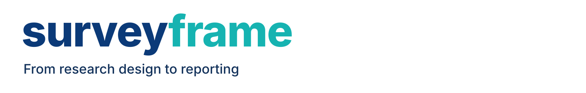
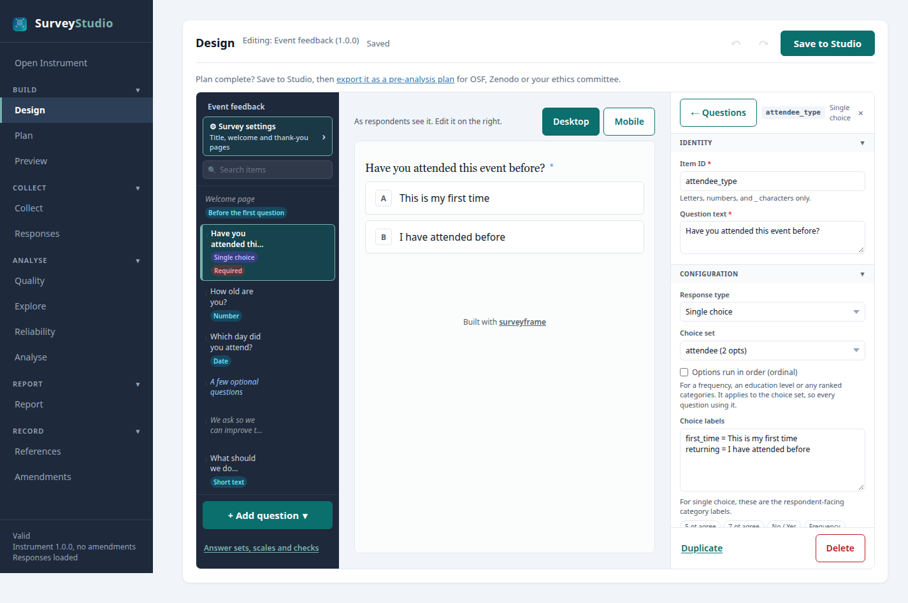
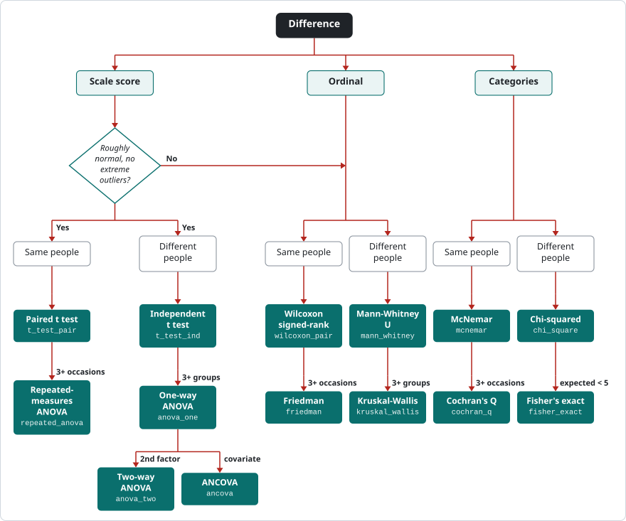

<p align="center">
  
</p>

<h3 align="center">Plan, run and report survey research in R.</h3>

<p align="center">
Design, collect and analyse in SurveyStudio, where you point and click through every step, or script every step in R.<br/>
Same study, same verifiable file.
</p>

<p align="center">
  <a href="https://CRAN.R-project.org/package=surveyframe"></a>
  <a href="https://cran.r-project.org/package=surveyframe"></a>
  <a href="https://opensource.org/licenses/MIT"></a>
  <a href="https://github.com/MohammedAliSharafuddin/surveyframe"></a>
  <a href="https://github.com/MohammedAliSharafuddin/surveyframe/actions/workflows/R-CMD-check.yaml"></a>
</p>

<p align="center">
  Visit the <a href="https://surveyframe.org/">website</a> to
  <a href="https://surveyframe.org/articles/start.html">get started</a>, browse the
  <a href="https://surveyframe.org/articles/templates.html">templates</a> and the
  <a href="https://surveyframe.org/articles/docs.html">documentation</a>,
  <a href="https://surveyframe.org/verify/">verify a file</a> or
  <a href="https://surveyframe.org/articles/cite.html">cite surveyframe</a>.
</p>

<p align="center">
  
</p>

## What you get

You write your analysis plan with your questions. When the answers arrive, surveyframe runs that plan and writes the report.

- **A point-and-click studio.** Build, preview and run a whole study in SurveyStudio, from 1 line of R or the RStudio Addins menu.
- **The plan before the data.** Each research question is tied to its test and its variables at design time, ready to preregister.
- **APA 7 reports.** Create tables, figures, effect sizes and references in HTML, Word, PDF or Quarto.
- **Psychometrics and models.** Run reliability, item analysis and EFA, and write CFA, SEM and PLS-SEM syntax from 1 model.
- **Small samples and decisions.** Use exact tests, Firth regression and 10 multi-criteria decision methods.
- **Files anyone can verify.** Every questionnaire carries a sealed hash and an amendment log.

Free and open source under the MIT licence, with no account needed. The analysis
runs on your computer, and you choose where responses are collected and stored.

## How it works

| Stage | In SurveyStudio |
|---|---|
| **Build** | Write the questions, the analysis plan and the model, then preview the survey |
| **Collect** | Export the survey as 1 web page, collect into your own Google Sheet or any survey tool, then load the responses |
| **Analyse** | Check quality and reliability, then run the plan |
| **Report** | Get a results report you can edit in Word |
| **Record** | Keep the references and every amendment with the study |

## Which test?

<p align="center">
  
</p>

Each box gives the test and the method ID the plan stores. Relationships, predictions and measurement have their own charts in [Choose a method](https://surveyframe.org/articles/docs/methods/choose-a-method.html).

## Get started

```r
install.packages("surveyframe")
surveyframe::launch_studio()
```

Or open RStudio's **Addins** menu, choose **surveyframe: Try a demo** and pick a study. It opens in SurveyStudio with its questionnaire, plan and demonstration responses.

The development version, with the newest features before they reach CRAN:

```r
# install.packages("remotes")
remotes::install_github("MohammedAliSharafuddin/surveyframe")
```

## Optional R code

```r
library(surveyframe)
demo    <- sframe_demo("first_survey")
results <- run_analysis_plan(demo$responses, demo$instrument)
render_report(demo$instrument, data = demo$responses)
```

Already have data from Google Forms, Qualtrics or REDCap? Describe the questions, then load the CSV with `read_responses()`. The [how-to guides](https://surveyframe.org/articles/guides.html) show each analysis step by step.

## Is it the right tool?

Use surveyframe when:

- you want the questionnaire and its analysis plan kept together, planned before collection or added to data you already have
- you are validating a scale or fitting a measurement model
- you need an audit trail showing the plan did not change after the results

Another tool fits better when:

- you only need to collect responses, with no plan up front (Google Forms, Qualtrics, REDCap, [surveydown](https://github.com/surveydown-dev/surveydown)). surveyframe can read their exported data later.
- you need weighting or complex-sample variance ([survey](https://cran.r-project.org/package=survey), [srvyr](https://cran.r-project.org/package=srvyr)). surveyframe works alongside them.

## FAQ

**Do I need to know R?** No. SurveyStudio covers every stage. R is there when you want to script it.

**Can I use data I have already collected?** Yes. Describe the questions and load the CSV with `read_responses()`.

**What is a pre-declared analysis plan?** Your research questions, each tied to a test and its variables, written before any response arrives.

**How long will it be available?** The GitHub repository is the canonical source, and every CRAN release is deposited on Zenodo with its own DOI.

<h2 id="cite">Cite</h2>

```r
citation("surveyframe")
```

## Learn more

- [Quantitative Analysis with Small Samples](https://doi.org/10.5281/zenodo.20221929), a companion textbook on the small-sample methods in surveyframe.
- [Website](https://surveyframe.org/), [questionnaire templates](https://surveyframe.org/articles/templates.html), [how-to guides](https://surveyframe.org/articles/guides.html) and [changelog](https://surveyframe.org/news/index.html).

## Contributing

Questions and bug reports are welcome in [issues](https://github.com/MohammedAliSharafuddin/surveyframe/issues).

## Licence

MIT, copyright 2026 Mohammed Ali Sharafuddin. See [LICENSE](LICENSE).
