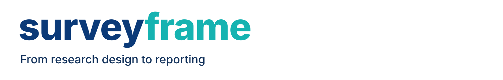
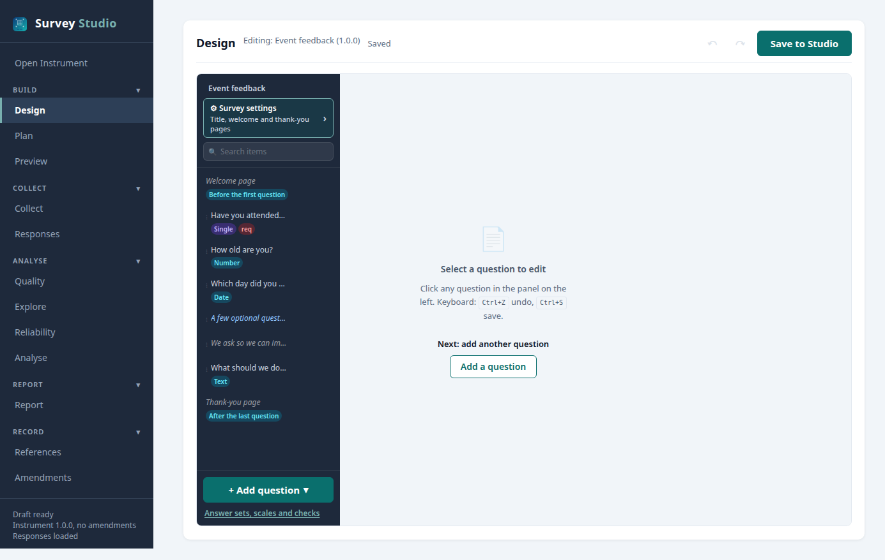

<p align="center">
  
</p>

<h3 align="center">Plan, run and report survey research in R.</h3>

<p align="center">
Design, collect and analyse in the no-code SurveyStudio, or script every step in R.<br/>
Same study, same verifiable file.
</p>

<p align="center">
  <a href="https://CRAN.R-project.org/package=surveyframe"></a>
  <a href="https://cran.r-project.org/package=surveyframe"></a>
  <a href="https://opensource.org/licenses/MIT"></a>
  <a href="https://github.com/MohammedAliSharafuddin/surveyframe"></a>
</p>

<p align="center">
  <a href="https://surveyframe.org/">Website</a> ·
  <a href="https://surveyframe.org/articles/start.html">Get started</a> ·
  <a href="https://surveyframe.org/articles/templates.html">Templates</a> ·
  <a href="https://surveyframe.org/articles/docs.html">Docs</a> ·
  <a href="https://surveyframe.org/verify/">Verify a file</a> ·
  <a href="https://surveyframe.org/articles/cite.html">Cite</a>
</p>

<p align="center">
  
</p>

## What you get

You write your analysis plan with your questions. When the answers arrive, surveyframe runs that plan and writes the report.

- **A no-code studio.** Build, preview and run a whole study in SurveyStudio, from 1 line of R or the RStudio Addins menu.
- **The plan before the data.** Each research question is tied to its test and its variables at design time, ready to preregister.
- **APA 7 reports.** Tables, figures, effect sizes and references, in HTML, Word, PDF or Quarto.
- **Psychometrics and models.** Reliability, item analysis, and EFA, CFA, SEM and PLS-SEM syntax from 1 model.
- **Small samples and decisions.** Exact tests, Firth regression and 10 multi-criteria decision methods.
- **Files anyone can verify.** Every questionnaire carries a sealed hash and an amendment log.

Free and open source under MIT. No account. Your data stays on your computer.

## How it works

| Stage | In SurveyStudio |
|---|---|
| **Build** | Write the questions, the analysis plan and the model, then preview the survey |
| **Collect** | Share the survey and bring the responses back in |
| **Analyse** | Check quality and reliability, then run the plan |
| **Report** | Get a results report you can edit in Word |
| **Record** | Keep the references and every amendment with the study |

## Get started

```r
install.packages("surveyframe")
surveyframe::launch_studio()
```

Or open RStudio's **Addins** menu and choose **surveyframe: Try a demo**: pick a study, and it opens in SurveyStudio with its questionnaire, plan and demonstration responses.

The development version, with the newest features before they reach CRAN:

```r
# install.packages("remotes")
remotes::install_github("MohammedAliSharafuddin/surveyframe")
```

## For R users

```r
library(surveyframe)
demo    <- sframe_demo("first_survey")
results <- run_analysis_plan(demo$responses, demo$instrument)
render_report(demo$instrument, data = demo$responses)
```

Already have data from Google Forms, Qualtrics or REDCap? Describe the questions, then load the CSV with `read_responses()`. The [method guides](https://surveyframe.org/articles/guides.html) show each analysis step by step.

## Is it the right tool?

Use surveyframe when:

- the analysis should be decided before collection
- you are validating a scale or fitting a measurement model
- you need an audit trail showing the plan did not change after the results

Another tool fits better when:

- you only need to collect responses with no plan up front (Google Forms, Qualtrics, REDCap, [surveydown](https://github.com/surveydown-dev/surveydown)). surveyframe reads their exported data later.
- you need weighting or complex-sample variance ([survey](https://cran.r-project.org/package=survey), [srvyr](https://cran.r-project.org/package=srvyr)). surveyframe works alongside them.

## FAQ

**Do I need to know R?** No. SurveyStudio covers every stage. R is there when you want to script it.

**Can I use data I have already collected?** Yes. Describe the questions and load the CSV with `read_responses()`.

**What is a pre-declared analysis plan?** Your research questions, each tied to a test and its variables, written before any response arrives.

**How long will it be available?** The GitHub repository is the canonical source, and every CRAN release is deposited on Zenodo with its own DOI.

<h2 id="cite">Cite</h2>

```r
citation("surveyframe")
```

## Learn more

- [Quantitative Analysis with Small Samples](https://doi.org/10.5281/zenodo.20221929), a companion textbook on the small-sample methods in surveyframe.
- [Website](https://surveyframe.org/), [questionnaire templates](https://surveyframe.org/articles/templates.html), [method guides](https://surveyframe.org/articles/guides.html) and [changelog](https://surveyframe.org/news/index.html).

## Contributing

Questions and bug reports are welcome in [issues](https://github.com/MohammedAliSharafuddin/surveyframe/issues).

[](https://github.com/MohammedAliSharafuddin/surveyframe/actions/workflows/R-CMD-check.yaml)

## License

MIT. See [LICENSE](LICENSE).
