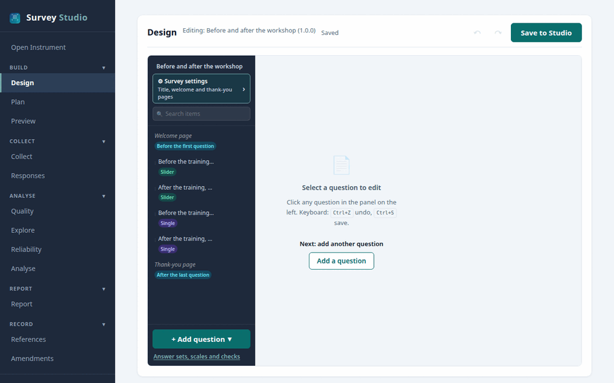
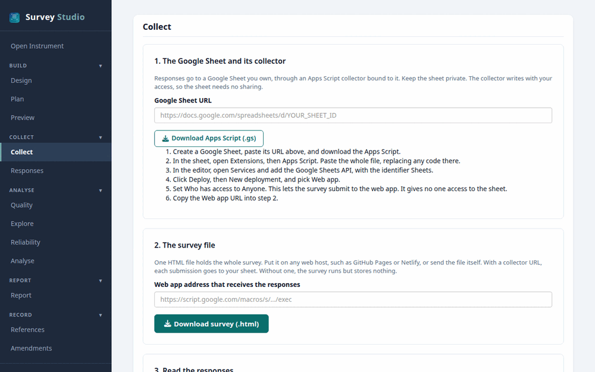
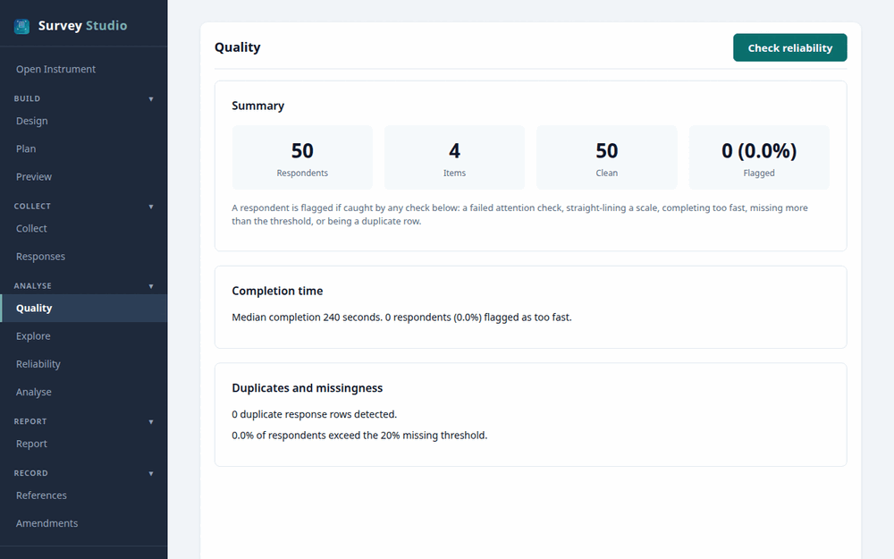
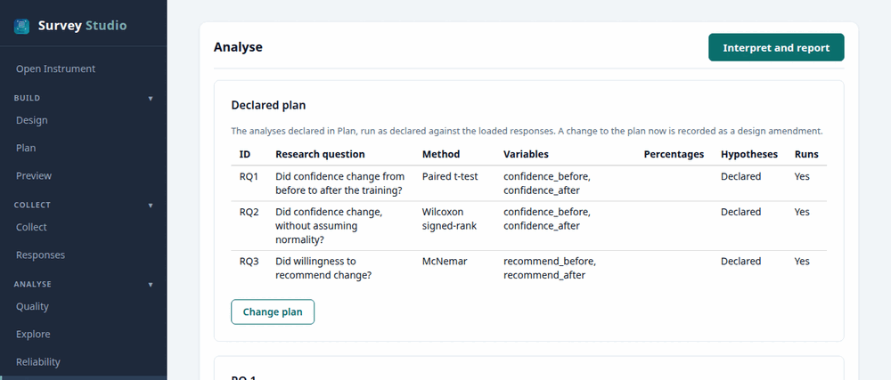
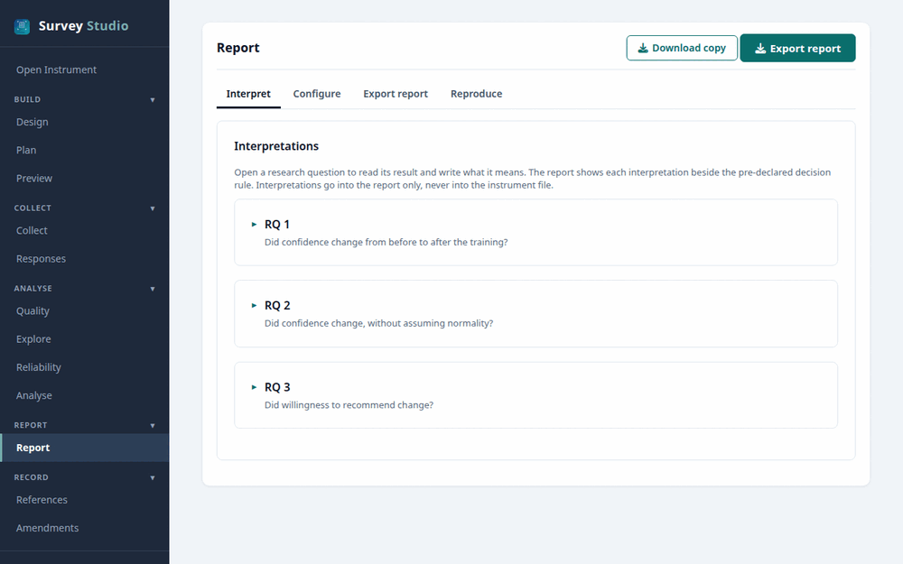

SurveyStudio takes a study through 5 stages without any code: design the
questionnaire and its analysis plan, collect the answers, check them, run the
planned analyses, and write the report. Everything you make is saved in 1
`.sframe` file.

The screenshots show the training evaluation template, measured before and
after the training. Its answers are demonstration data, not collected from
participants, and every output made from them says so.

## Open SurveyStudio

1. Install R, RStudio and surveyframe, as the
   [Get started](https://surveyframe.org/articles/start.html) page shows.
2. In RStudio, open the **Addins** menu and choose
   **surveyframe: Try a demo**.
3. Pick **paired** to follow this page, or any template that is close to your
   own study.

To work on a study of your own, choose **Open Instrument** in SurveyStudio's
left menu and select your `.sframe` file.

## 1. Design

{width=100%}

The Design screen holds the questions, the answer options, the welcome and
thank-you pages, and the study the questionnaire serves. Choose **Plan** in
the left menu to write the analysis plan: each research question with its
hypotheses, the method, the variables and the decision rule.

When you finish, press **Save to Studio**.

**Plan complete?** Go to the **Report** screen and press
**Export pre-analysis plan**. It writes a document, as HTML, PDF or Word, that
you can submit to OSF, Zenodo or your ethics committee before you collect any
answers.

## 2. Collect

{width=100%}

The Collect screen downloads your survey as 1 web page that respondents open
in any browser. To store each answer in a Google Sheet, it also gives you the
Apps Script collector, with step-by-step instructions.

## 3. Check

{width=100%}

When the answers arrive, load them on the **Responses** screen. The
**Quality** screen then shows who failed an attention check, who answered too
fast, who gave the same answer to every item of a scale, and how much is
missing.

## 4. Analyse

{width=100%}

The Analyse screen runs your plan exactly as you declared it. If you change
the plan after the answers arrive, SurveyStudio records the change as an
amendment, so readers can see what changed and when.

## 5. Report

{width=100%}

The Report screen lets you write an interpretation for each result. It is
printed beside the decision rule you declared before the results. Then press
**Export report** for an APA 7 report in HTML, Word, PDF or OpenDocument.

The report names your questionnaire's hash, so a reader can check at
[surveyframe.org/verify](https://surveyframe.org/verify/) that the
questionnaire analysed is the one you planned.

## Prefer to write code?

Every stage above can also be run in R, on the same `.sframe` file. See
[Run a study in R](run-a-study-in-r.html).
