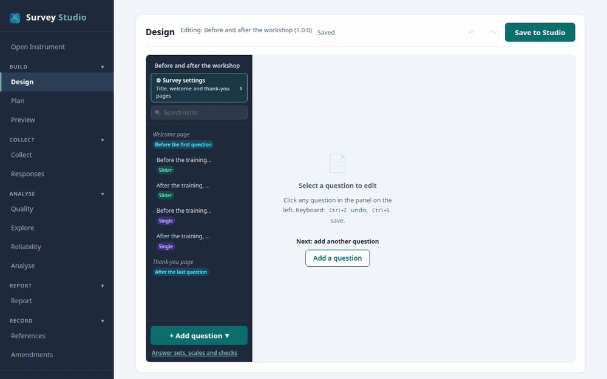
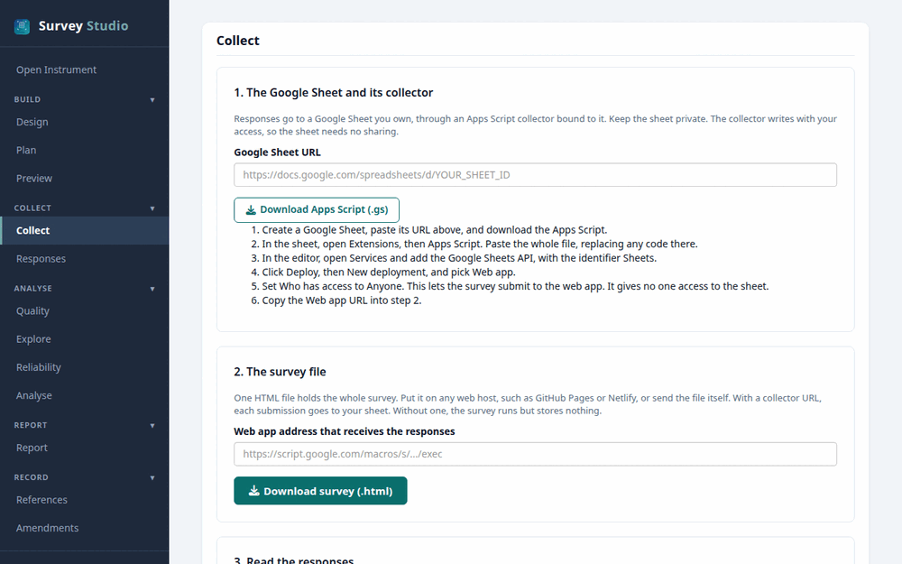
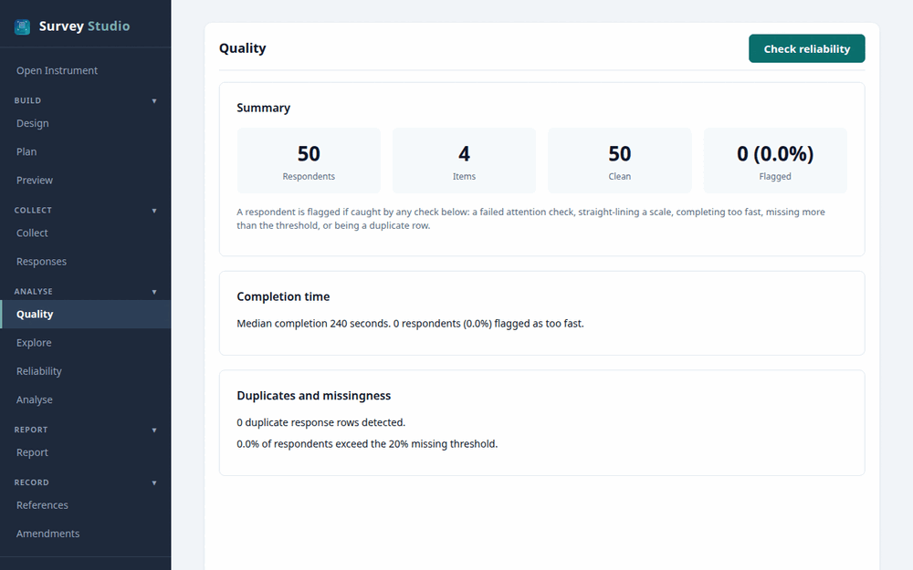
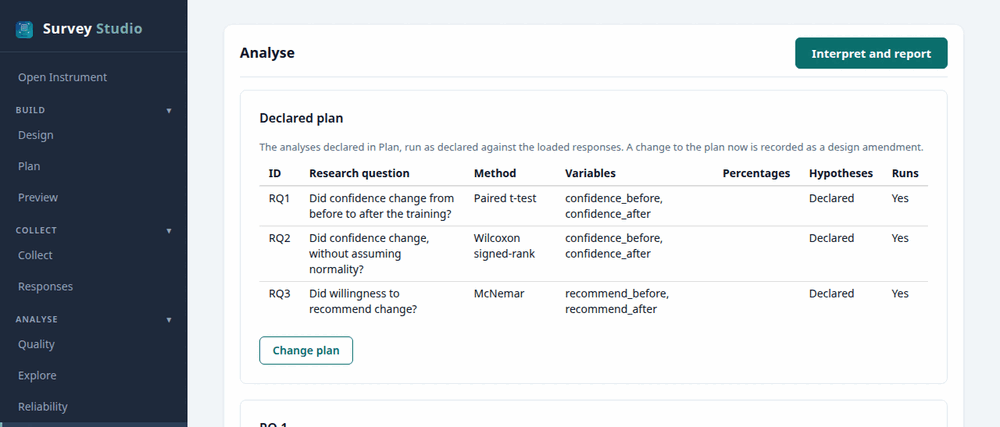
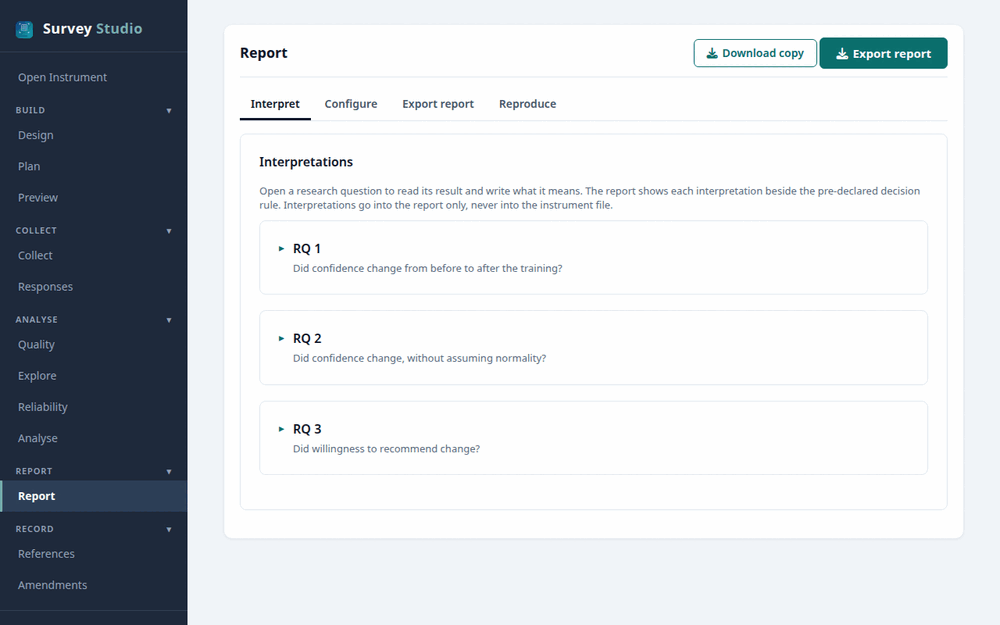

```{r setup, include = FALSE}
knitr::opts_chunk$set(collapse = TRUE, comment = "#>", eval = FALSE)
```

A study in surveyframe passes through 5 stages: design the questionnaire and
its analysis plan, collect the answers, check them, run the planned analyses,
and write the report. You can take every stage in SurveyStudio, with no code,
or in R, with a few functions. Both routes read and write the same `.sframe`
file, so a study can start in one and finish in the other.

The screenshots show the `paired` demo, a training evaluation measured before
and after, which you can open yourself with `sframe_demo("paired")`. Its data
is demonstration data, not collected from participants, and every output made
from it says so.

## Open a study

In SurveyStudio: in RStudio, open the Addins menu and choose
**surveyframe: Try a demo**, or run

```{r}
launch_studio(demo = "paired", screen = "design")
```

In R:

```{r}
d <- sframe_demo("paired")
d
```

To open a study of your own, give `launch_studio()` the instrument, or read
it in R with `read_sframe()`.

```{r}
ins <- read_sframe("my_study.sframe")
launch_studio(ins, screen = "design")
```

## 1. Design

{width=100%}

In SurveyStudio, the Design screen holds the questions, the answer sets, the
welcome and thank-you pages, and the study the instrument serves. Its Plan
entry opens the analysis plan: each research question with its hypotheses,
method, variables and decision rule.

In R, the same parts are built with `sframe_item()`, `sframe_choice_set()`,
`sframe_scale()` and `sframe_instrument()`, and the plan is a list of blocks
in `sframe_instrument(analysis_plan = )`. `write_sframe()` saves the file with
its integrity hash.

```{r}
write_sframe(d$instrument, "paired.sframe")
```

Before collecting, write the plan down. `render_report()` with no data writes
the pre-analysis plan, a document to submit to OSF, Zenodo or an ethics
committee.

```{r}
render_report(d$instrument, output_file = "paired-plan.pdf", format = "pdf")
```

## 2. Collect

{width=100%}

In SurveyStudio, the Collect screen downloads the survey as 1 HTML file and,
for a Google Sheet, the Apps Script collector that stores each answer.

In R:

```{r}
export_survey(d$instrument, "paired-survey.html",
              endpoint_url = "https://script.google.com/macros/s/.../exec")
export_google_sheet(d$instrument, sheet_url = "https://docs.google.com/spreadsheets/d/...")
```

## 3. Check

{width=100%}

In SurveyStudio, load the answers on the Responses screen, then read the
Quality screen: who failed an attention check, who answered too fast, who
straight-lined a scale, and how much is missing.

In R:

```{r}
responses <- read_responses("paired-responses.csv", d$instrument,
                            respondent_id = "respondent_id")
sframe_quality_results(responses, d$instrument)
```

## 4. Analyse

{width=100%}

In SurveyStudio, the Analyse screen runs the declared plan, as declared,
against the loaded answers. A change to the plan after the answers arrive is
recorded as an amendment.

In R:

```{r}
results <- run_analysis_plan(d$responses, d$instrument)
results
```

## 5. Report

{width=100%}

In SurveyStudio, the Report screen takes an interpretation for each result,
written after the results and printed beside the decision rule declared
before them, and exports the report in APA 7 style.

In R:

```{r}
render_report(d$instrument, d$responses, output_file = "paired-report.docx",
              format = "docx")
```

The report names the instrument's hash, so a reader can check that the
questionnaire analysed is the one planned.

## Without R

SurveyBuilder, the questionnaire designer inside SurveyStudio's Design screen,
also runs on its own in a web browser, offline, from `launch_builder()`. It
saves `.sframe` files that either route opens.
